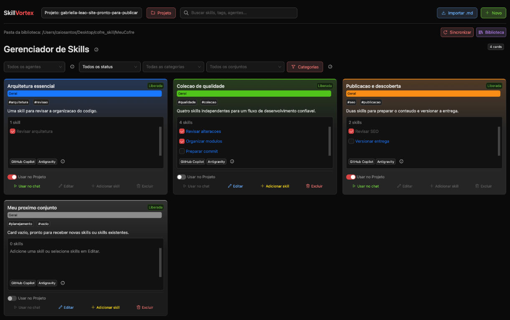
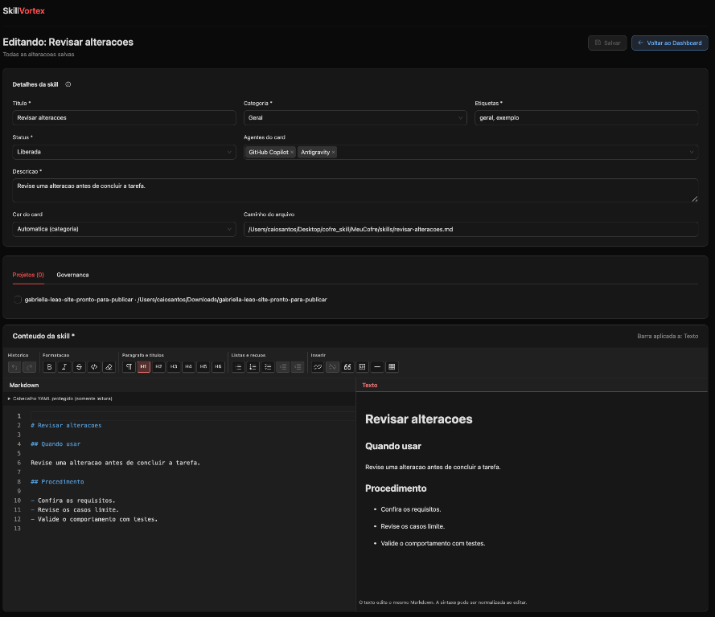
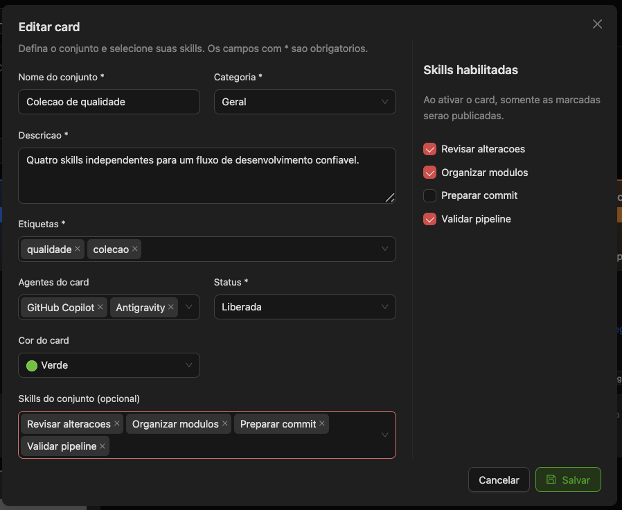
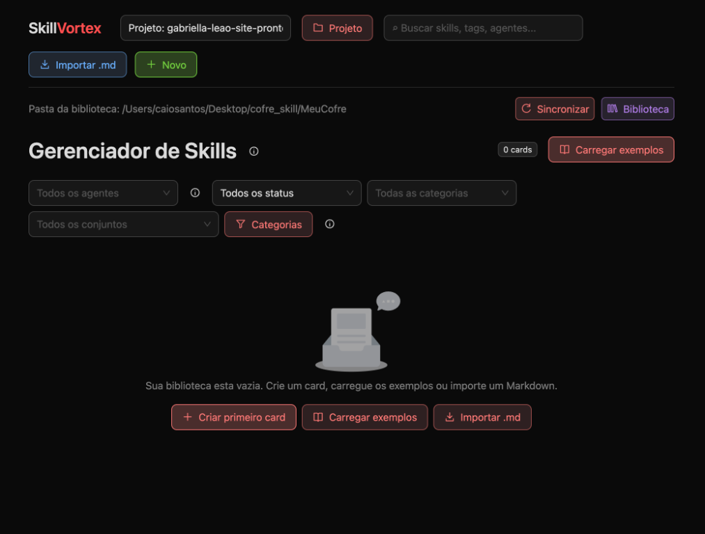
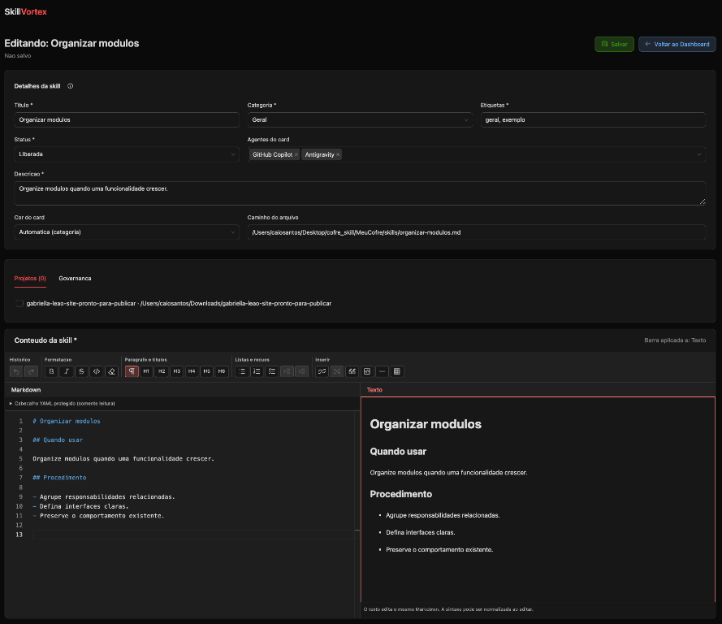
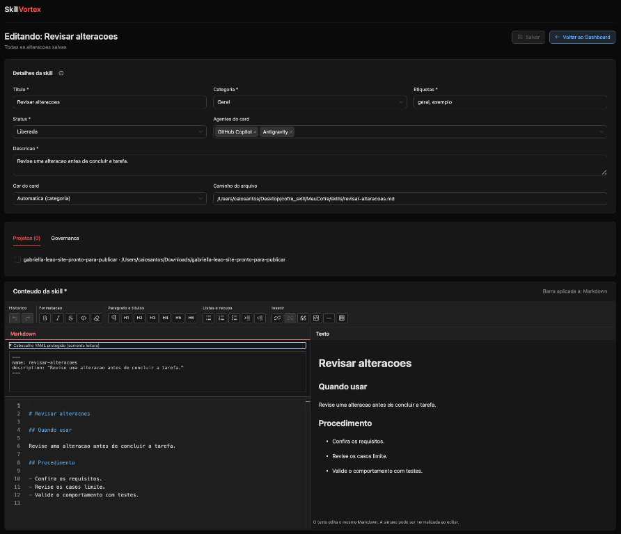
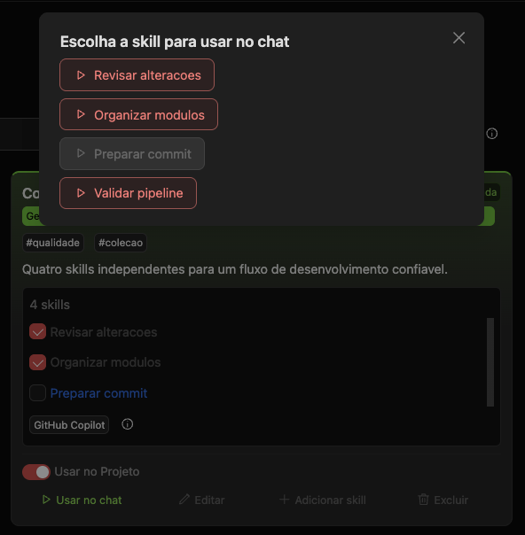
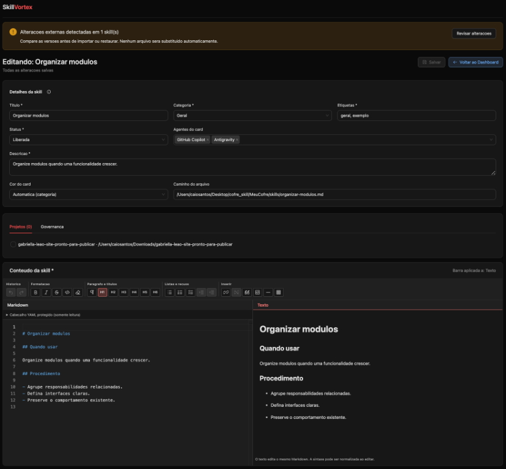
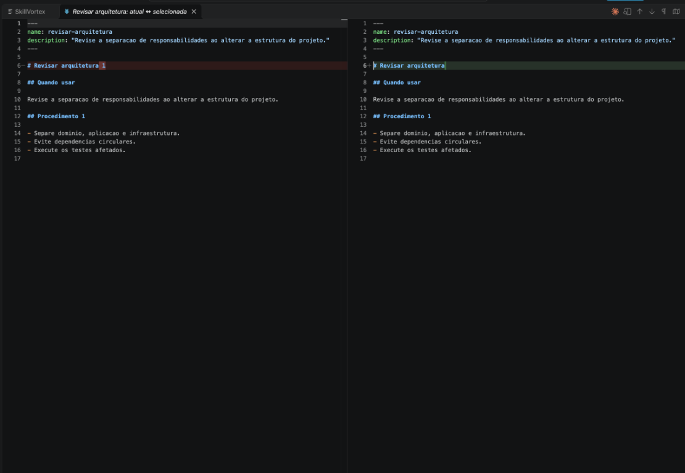
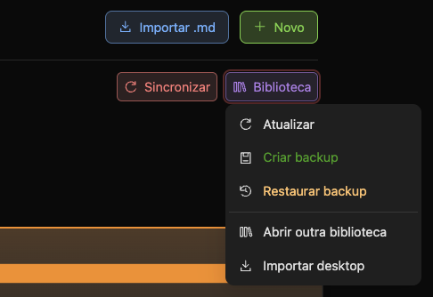

<div align="center">


# SkillVortex Extension

**Suas skills de IA organizadas. Seus projetos no controle. Dentro do VS Code.**

Extensão para criar, editar e organizar instruções Markdown em uma biblioteca local,
selecionando quais skills publicar em cada projeto e agente.
Inclui **MindCards**, um módulo independente para anotações e regras de negócio
conectadas, armazenadas no mesmo cofre.

**🔌 VS Code · ⚛️ React · 🔷 TypeScript · 🎨 Ant Design · 📝 Monaco + Tiptap · 🗃️ SQLite/WASM**

[Instalar](#-instalação) · [Começar](#-primeiros-passos) · [Telas](#-conheça-as-telas) · [Guia de uso](#-guia-de-uso) · [Sincronização](#-alterações-externas-comparação-e-merge) · [Desenvolvimento](#-desenvolvimento)

</div>

---

> [!IMPORTANT]
> **O que esta extensão faz:** mantém uma biblioteca local e publica as skills
> selecionadas como `SKILL.md` nas pastas dos agentes do projeto.
> GitHub Copilot usa `.github/skills/`; Antigravity usa `.agents/skills/`.
> **Usar no chat** prepara o comando da skill no chat do Copilot; você ainda
> revisa a solicitação e envia. A extensão não executa demandas nem gera skills
> com IA automaticamente.

## 🧭 Navegação

- [✨ Recursos disponíveis](#-recursos-disponíveis)
- [🖼️ Conheça as telas](#-conheça-as-telas)
- [📦 Instalação](#-instalação)
- [🚀 Primeiros passos](#-primeiros-passos)
- [📚 Guia de uso](#-guia-de-uso)
- [🗂️ MindCards: notas e regras de negócio](#mindcards)
- [📝 Editor de Texto e Markdown](#-editor-de-texto-e-markdown)
- [🔌 Projetos, agentes e publicação](#-projetos-agentes-e-publicação)
- [🔄 Alterações externas, comparação e merge](#-alterações-externas-comparação-e-merge)
- [💾 Arquivos, dados e backup](#-arquivos-dados-e-backup)
- [📥 Migração do desktop](#-migração-do-desktop)
- [🛠️ Desenvolvimento](#-desenvolvimento)
- [🏗️ Arquitetura](#-arquitetura)
- [🩺 Solução de problemas](#-solução-de-problemas)
- [🚧 Limites atuais](#-limites-atuais)

## ✨ Recursos disponíveis

| | Recurso | Como funciona |
| --- | --- | --- |
| 📚 | Biblioteca portátil | Markdown e metadados em uma pasta local, sem depender do aplicativo desktop |
| 🗂️ | Cards de conjuntos | Agrupe de zero a várias skills, cada uma com seu próprio Markdown |
| 🔎 | Busca e filtros | Localize por texto, agentes, status, categoria e conjunto |
| ☑️ | Seleção individual | Escolha as skills habilitadas sem removê-las do card |
| 🚦 | Liberação e ativação separadas | **Liberada/Bloqueada** define permissão; **Usar no Projeto** controla publicação |
| 📝 | Dois editores sincronizados | Markdown no Monaco e texto visual no Tiptap alteram o mesmo conteúdo |
| 🎛️ | Barra de formatação | Ícones agrupados atuam na seleção do painel ativo |
| 🔒 | YAML protegido | Cabeçalho separado e somente leitura no editor integrado |
| 🔌 | Publicação por agente | Ative e desative destinos sem duplicar o original da biblioteca |
| 💬 | Usar no chat | Abra o Copilot com o comando da skill ativa preenchido |
| 📥 | Importação de Markdown | Selecione arquivos ou busque skills nas pastas dos agentes |
| 🔄 | Revisão de mudanças externas | Compare, mescle manualmente ou escolha qual versão adotar |
| 💾 | Backup e recuperação | Cópias locais da biblioteca e proteção antes de substituir versões |
| 🧳 | Migração do desktop | Importe um banco SQLite para uma nova biblioteca, sem alterar a origem |
| 🗂️ | MindCards | Notas visuais em `.md`, pastas coloridas, etiquetas, vínculos e referências de entrada |
| 🧭 | Escolha de área | Tela inicial para SkillVortex ou MindCards, com troca disponível no menu superior |

## 🖼️ Conheça as telas

As capturas abaixo mostram a extensão em uso. Algumas são de etapas anteriores
da interface; os procedimentos documentados correspondem ao funcionamento atual.
Caminhos, projetos, conteúdo e disposição dos controles variam conforme seu ambiente.
Clique nas imagens para abrir os arquivos em tamanho original.

### 📚 Dashboard · Gerenciador de Skills

A tela central reúne projeto ativo, pesquisa, filtros e cards em três colunas.
Os checkboxes selecionam membros; o switch publica ou desativa o conjunto nos
destinos exibidos. Cards ativos usam um fundo mais claro.



### 📝 Editor · Texto e Markdown

Os campos de cadastro ficam acima dos painéis. **Projetos** e **Governança**
também ficam acima da edição. Markdown e Texto são editáveis, sincronizados
e compartilham a barra de ícones.



### 🗂️ Edição do card

O formulário define os metadados e quais skills pertencem ao conjunto.
A lateral **Skills habilitadas** determina quais serão publicadas ao ativá-lo.



Outras telas e estados estão ilustrados nas seções correspondentes abaixo.

## 📦 Instalação

### Para usar a extensão

Requisitos: **VS Code 1.95 ou superior**, ambiente local e workspace confiável.
Você não precisa de Node.js para instalar um VSIX já gerado.

1. Obtenha o VSIX de uma origem confiável.
2. No VS Code, execute **Extensions: Install from VSIX...**.
3. Selecione o pacote do SkillVortex.
4. Execute **Developer: Reload Window**.
5. Clique em **SkillVortex** na barra de status inferior ou execute
   **SkillVortex: Abrir biblioteca** na Paleta de Comandos.
6. Escolha **SkillVortex** ou **MindCards** na tela inicial.

Não é necessário instalar ou executar o aplicativo desktop.
O empacotamento local não significa que exista uma versão publicada no Marketplace.

### Gerar um VSIX a partir do código

Com Node.js **22.12 ou superior**, npm e Git:

```sh
npm ci
npm run package
```

O comando compila o código atual e gera o VSIX em `builds/`, com nome e versão
definidos em [package.json](./package.json). Instale o arquivo recém-gerado.
Se o build falhar, corrija a falha antes de instalar; não use um pacote antigo
como se contivesse as alterações atuais.

## 🚀 Primeiros passos

Ao abrir a Webview, escolha a área desejada. **Início** retorna ao seletor;
os botões **SkillVortex** e **MindCards** permitem trocar de área sem fechar a aba.
Alterações não salvas exigem confirmação antes da troca.
O fluxo abaixo corresponde à área de skills.

1. **Crie ou abra uma biblioteca.** Escolha uma pasta local para os dados.
   Mantenha a biblioteca fora das pastas dos projetos onde publicará skills.
2. **Adicione conteúdo.** Crie um card, importe Markdown ou carregue exemplos.
3. **Cadastre skills.** No card, use **Adicionar skill**, preencha os campos e salve.
4. **Escolha os agentes.** Defina GitHub Copilot, Antigravity ou ambos no card.
5. **Selecione os membros.** Marque somente as skills que deseja publicar.
6. **Ative Usar no Projeto.** A extensão associa uma pasta local e publica os arquivos.
7. **Use a skill.** Para Copilot, clique em **Usar no chat**, revise o pedido e envie.

> [!NOTE]
> Instalar a extensão ou abrir uma biblioteca não importa arquivos nem ativa
> exemplos automaticamente. **Liberada** também não significa **ativa**.

### Biblioteca vazia e exemplos

Sem cards, a tela oferece **Criar primeiro card**, **Carregar exemplos**
e **Importar .md**.



**Carregar exemplos** exige confirmação e está disponível somente quando não há
cards, nem mesmo vazios. Cria quatro conjuntos com **1, 4, 2 e 0 skills**:
sete Markdown com cabeçalho `name`/`description`, usando categorias já existentes.
Não procura arquivos no projeto, não exige projeto ativo e não publica nada
automaticamente. Os exemplos podem ser editados.

## 📚 Guia de uso

### Conceitos

| Conceito | Significado |
| --- | --- |
| **Biblioteca / cofre** | Pasta local que armazena os Markdown, o catálogo, os projetos e os backups |
| **Skill** | Instrução Markdown independente, com título, descrição, categoria, etiquetas e status |
| **Card / conjunto** | Agrupamento de skills com metadados, agentes e seleção de membros habilitados |
| **Projeto** | Pasta local onde as skills selecionadas podem ser publicadas |
| **Agente** | Destino de publicação, como GitHub Copilot ou Antigravity |
| **Publicação** | Cópia gerenciada `SKILL.md` dentro da pasta do projeto |

Cada skill possui **um único Markdown na biblioteca** e pertence a **no máximo
um card**. Skills importadas ou antigas sem conjunto aparecem em cards individuais.
Remover o vínculo de uma skill com um conjunto não apaga seu Markdown:
ela pode passar a aparecer individualmente.

### Busca, filtros e categorias

- A pesquisa considera nomes, descrições, categorias, etiquetas, agentes e membros.
- Combine filtros de agente, status, categoria e conjunto.
- **Todos os agentes** mostra a biblioteca sem restringir o destino.
- Labels personalizadas de agente servem para organização; não criam integrações.
- **Categorias** permite criar categorias e excluir as vazias, após confirmação.
  Mova as skills e os cards antes de excluir uma categoria em uso.

Os cards mantêm três colunas, sem expandir para ocupar posições vazias.
A lista interna reserva três linhas e mantém o trilho de rolagem visível;
role para alcançar os demais membros.

### Criar e editar cards

Use **Novo > Novo card** ou **Criar primeiro card**. Informe nome, categoria,
descrição, etiquetas, status e ao menos um agente compatível. A cor é configurável;
**Automática (categoria)** usa a identificação visual da categoria.

Um card pode começar vazio. Em **Editar**, selecione skills existentes; em
**Adicionar skill**, crie um novo membro. Skills vinculadas a outro card
ficam indisponíveis no seletor: remova o vínculo anterior para movê-las.
Cards vazios não podem ser ativados nem usados no chat.

**Títulos são únicos em toda a biblioteca**, tanto para cards quanto para skills.
A comparação ignora maiúsculas/minúsculas, espaços nas pontas e diferenças de
normalização Unicode. Duplicações são recusadas, sem sobrescrita ou renomeação
automática de registros existentes.

### Habilitar skills individualmente

Use os checkboxes junto aos títulos ou a lateral **Skills habilitadas** da modal.
Novas skills começam habilitadas.

| Ação | Resultado |
| --- | --- |
| Desmarcar com o card desligado | Altera a seleção, sem publicar arquivos |
| Marcar/desmarcar com o card ativo | Publica/desativa aquela skill no projeto atual e nos agentes exibidos |
| Desligar o card | Desativa os membros nos destinos exibidos e preserva os checkboxes |
| Religar o card | Publica somente os membros selecionados |
| Desmarcar todos | O card pode continuar ligado, mas sem membros publicados nesses destinos |

A seleção pertence ao card e vale para próximas ativações em outros projetos.
Alterações imediatas não são propagadas a projetos ou agentes que não estão
sendo controlados na visualização atual. Desmarcar não exclui arquivos da biblioteca.

### Status e ações disponíveis

| Controle | Significado |
| --- | --- |
| **Liberada** | A skill/card pode ser ativada; não comprova revisão ou qualidade |
| **Bloqueada** | Impede novas ativações e uso no chat; salvar o bloqueio de uma skill remove seus vínculos |
| **Usar no Projeto** | Indica/controla a ativação no projeto e destinos exibidos |
| Checkbox da skill | Define participação na publicação do conjunto |

Para editar ou excluir, desative as skills em **todos os projetos e agentes**.
As ações indisponíveis aparecem desabilitadas; trocar um filtro não remove vínculos.

**Excluir card** remove também suas skills exclusivas, Markdown, arquivos
desativados e pastas publicadas identificadas, após confirmação dos caminhos.
**Excluir skill individual** remove o registro e seus arquivos gerenciados,
retirando-a dos conjuntos sem excluir os conjuntos.

> [!WARNING]
> A confirmação de exclusão pode incluir outros arquivos dentro das pastas
> publicadas identificadas. Revise a lista antes de confirmar.
> Origens importadas protegidas e pastas sem propriedade confiável bloqueiam
> a exclusão, em vez de serem removidas silenciosamente.

### Importar Markdown

**Importar .md** copia os arquivos selecionados para a biblioteca, sem editar
o original. Arquivos acima de **2 MB**, YAML inválido e títulos duplicados são recusados.
Os rascunhos usam nomes livres, como **Nova Skill 2**.

No menu **Projeto**, **Buscar skills no projeto** procura em:

```text
.github/skills/
.agents/skills/
.agent/skills/
```

A busca considera a pasta associada e as pastas locais abertas no workspace.
Mostra os resultados para seleção antes de importar; não percorre todo o disco.
Aceita Markdown solto ou em subpastas, sem exigir o nome `SKILL.md`.

Ignora links simbólicos, diretórios gerados e nomes convencionais de documentação,
como `README.md`, `CONTRIBUTING.md`, `CHANGELOG.md`, `SECURITY.md` e `CONFIG.md`.
Também ignora diretórios auxiliares, como `docs`, `references`, `examples`,
`assets` e `config`. Se uma skill for omitida por essas convenções, selecione-a
manualmente com **Importar .md**. A busca interrompe com erro acima de
50.000 entradas ou 1.000 Markdown.

Arquivos já importados são ignorados ao importar novamente. Publicações do próprio
SkillVortex aparecem desmarcadas na busca. A importação é de **Markdown**, não de
pacotes completos com scripts e assets; revise referências externas.

<a id="mindcards"></a>

## 🗂️ MindCards: notas e regras de negócio

O MindCards é um **módulo separado**, não um novo tipo de skill. Compartilha o
cofre, o padrão visual, o editor Texto e o backup, mas mantém arquivos, metadados,
pastas e vínculos próprios. Não publica notas em agentes, não altera os cards de
skills e não depende dos status ou vínculos dos projetos.
A integração entre os dois módulos não está implementada.
O MindCards mantém os fundos escuros neutros do SkillVortex em campos, menus,
janelas e editor, com azul como identidade nas seleções e ferramentas. As ações
usam cores semânticas: verde para criar/salvar/backup, azul-claro para abrir notas
e voltar, roxo para biblioteca/pastas, amarelo para exemplos e vermelho para excluir. As cores
personalizadas das pastas e os avisos semânticos continuam independentes.

Com o MindCards vazio, **Carregar exemplos** oferece, após confirmação,
exatamente quatro cards: **Frontend (React/TypeScript)**, **Backend (API/Node.js)**,
**Qualidade (testes/CI)** e **Squad (acordos e regras de negócio)**.
Cada card é uma nota editável em sua própria pasta colorida, com etiquetas e
conexões para as outras três notas. Os conteúdos são pontos de partida,
não regras aprovadas ou configurações aplicadas aos projetos. Nada é carregado
automaticamente e a ação fica indisponível quando já existem pastas ou notas.

### Criar e organizar

1. Na tela inicial, escolha **Abrir MindCards**.
2. Crie ou abra uma biblioteca existente, se necessário.
3. Use **Criar primeira pasta** ou o ícone **+** ao lado de **Pastas**.
4. Defina nome e cor usando a mesma paleta disponível no SkillVortex.
5. Selecione a pasta e clique em **Nova nota**.
6. Preencha título, pasta, etiquetas opcionais e texto; clique em **Salvar nota**
   ou use `Ctrl+S` / `Cmd+S`.

A lista permite filtrar por pasta, pesquisar títulos/etiquetas/nomes de pastas e filtrar uma
etiqueta. As notas aparecem com a cor da pasta, data de atualização e quantidade
de conexões. O ícone de edição da pasta permite renomear, alterar a cor ou
excluir uma pasta vazia. Para mover uma nota, altere sua pasta no editor e salve.
Na lateral, os botões de pasta têm dimensões uniformes e nomes em uma linha;
a coluna usa largura padrão de 320 px no desktop. Nomes que excedam o espaço
continuam disponíveis pela dica ao passar o cursor.

### Editor somente Texto

A nota usa o editor visual do SkillVortex e a mesma barra de formatação, sem
painel de sintaxe Markdown. Títulos, listas, tarefas, links e tabelas continuam
disponíveis. O conteúdo é gravado em `.md`; os metadados ficam em um cabeçalho
YAML gerenciado pelo módulo e não aparecem na área de texto.

### Arquivar e restaurar cards

Nos dois modulos, o icone de caixa **Arquivar**, no canto superior do card,
retira o card da lista principal sem excluir seus
arquivos. Abra **Arquivados** para consultar esses cards e clique em **Restaurar**
para devolve-los a lista principal. A pesquisa e os filtros continuam disponiveis
nessa tela.

No MindCards, notas arquivadas preservam texto, pasta, etiquetas, links e
referencias de entrada. No SkillVortex, o card precisa estar desativado em todos
os projetos antes de ser arquivado. Membros e selecoes do conjunto sao
preservados; restaure o card antes de ativa-lo novamente. Arquivar ou restaurar
nao ativa skills automaticamente. O estado de arquivamento acompanha os backups.

### Leitura de notas

Use **Leitura** no editor da nota para visualizar todo o conteúdo em largura
ampliada, sem campos de cadastro, lateral ou barra de ferramentas. O texto fica
somente leitura, mantém cores e tabelas e cresce com o conteúdo, usando a rolagem
da página em vez de uma área interna de altura fixa. **Voltar a editar** restaura
o editor. Alternar não salva nem descarta alterações pendentes: a leitura mostra
o rascunho atual.

Use uma ideia ou regra por nota e conecte contextos relacionados, no estilo
Zettelkasten. O formato do corpo é livre; não há template de regra obrigatório,
aprovação de regras ou geração com IA.

### Conexões e referências

**Notas relacionadas** seleciona vínculos explícitos com outras notas da mesma
biblioteca. Em **Conexões**, abra tanto as notas relacionadas quanto as que
fazem referência à nota atual. Os vínculos usam IDs internos estáveis e continuam
válidos após mudar título ou pasta. Não é necessário digitar sintaxe `[[wiki]]`.

Ao navegar pelas conexões, **Voltar a nota original** retorna diretamente à
primeira nota aberta, mesmo após visitar várias notas, e restaura seu modo de
leitura ou edição. O botão aparece no topo e na seção de conexões. Alterações
não salvas exigem confirmação antes de sair; **Voltar** continua levando à lista.

Uma nota referenciada não pode ser excluída até que seus vínculos de entrada
sejam removidos. Vínculos quebrados por edição externa aparecem como aviso.
Títulos repetidos na mesma pasta e nomes de pasta duplicados são recusados.

### Arquivos, mudanças externas e backup

Os arquivos ficam em `mindcards/` dentro do cofre. `pastas.json` guarda os nomes
e cores das pastas lógicas; cada nota é um Markdown com nome legível. Renomear
ou mover uma nota na interface preserva seu arquivo e ID. Nenhum dado é inserido
no catálogo de skills ou no índice SQLite.

Use **Atualizar** para reler edições feitas fora da extensão. O módulo verifica
o conteúdo anterior ao salvar/excluir e recusa um rascunho desatualizado, sem
descartar o texto local. Essa proteção não equivale a edição simultânea ou merge
automático. A edição visual aceita os spans de cor gerados pela barra;
outros tipos de HTML embutido exigem revisão externa.
O limite é de 2 MB por arquivo, incluindo metadados.

Novos backups incluem os arquivos do MindCards, cores e conexões. Restaurar
substitui o estado do módulo pelo snapshot, com ponto de recuperação do estado
anterior. Backups antigos sem suporte a MindCards preservam o módulo atual.
Os dois módulos ainda podem ser transportados juntos copiando o cofre completo.

## 📝 Editor de Texto e Markdown

### Metadados e salvamento

O editor apresenta título, categoria, etiquetas, status, agentes, descrição,
cor e caminho do arquivo. O caminho é informativo, somente leitura.
Título, categoria, ao menos uma etiqueta, status, descrição e conteúdo são
obrigatórios ao salvar. Cor e vínculos com projetos são opcionais.

**Novo > Nova Skill** abre um rascunho. Cadastro, arquivo e associação ao card
só são gravados ao salvar. Novos membros herdam os agentes do card;
skills independentes começam com os dois destinos compatíveis.

Use **Salvar** ou `Ctrl+S` / `Cmd+S`. O indicador **Não salvo** identifica alterações
pendentes. **Voltar ao Dashboard** solicita confirmação quando há alterações
para descartar; apenas abrir o editor não altera o arquivo.

<details>
<summary><strong>Ver exemplo de rascunho com alterações não salvas</strong></summary>



</details>

### Painéis sincronizados e barra de ferramentas

**Markdown** edita a sintaxe no Monaco. **Texto** permite edição visual no Tiptap.
São duas formas de editar o mesmo conteúdo, não arquivos distintos.
Em telas estreitas, os painéis ficam empilhados.

**Texto é o painel ativo por padrão.** Clique dentro de um painel ou no seu título
para direcionar a barra. O destaque e a indicação **Barra aplicada a** mostram o
destino. Não existe uma prévia somente leitura separada abaixo.

| Grupo | Ferramentas |
| --- | --- |
| Histórico | Desfazer e refazer |
| Formatação | Negrito, itálico, riscado, código em linha e limpar formatação |
| Cor do texto | No painel Texto, colorir o trecho selecionado ou remover sua cor |
| Parágrafo e títulos | Texto normal e títulos H1 a H6 |
| Listas e recuos | Marcadores, numeração, tarefas e aumentar/diminuir recuo |
| Inserir | Link, remover link, citação, bloco de código, separador e tabela |
| Editar tabela | No painel Texto, adicionar/excluir linhas, colunas e tabela |

Os ícones possuem dicas e nomes acessíveis. Botões refletem os estilos na seleção
ou posição do cursor, inclusive no Markdown. Títulos continuam reconhecidos no
final da linha e quando a seleção inclui sua quebra. Uma seleção que ultrapassa
um trecho formatado não destaca esse estilo. Ações indisponíveis são desabilitadas.

A edição visual pode normalizar a sintaxe Markdown. **Cor do texto**, disponível
no painel Texto do SkillVortex e no MindCards, permite escolher uma cor ou informar
um hexadecimal `#RRGGBB`. A cor é persistida no `.md` como
`<span style="color: #ff8800">trecho</span>`. **Remover cor** restaura a cor padrão;
**Limpar formatação** também remove a cor. O cabeçalho YAML não é alterado.

Esse HTML controlado é aceito pelo editor visual, inclusive com negrito e itálico.
Outras tags, atributos ou estilos HTML continuam bloqueando a edição visual para
preservar estruturas: use Markdown nas skills ou um editor externo no MindCards.
O painel Markdown permite consultar/editar os spans na sintaxe, sem seletor de cor.
Skills publicadas também levam esses spans; a aparência depende do renderizador
do agente. Alinhamento e tamanhos arbitrários de fonte não são adicionados.

### Cabeçalho YAML protegido

O cabeçalho existente fica separado em **Cabeçalho YAML protegido (somente leitura)**.
Pode ser expandido para consulta e cópia, mas não é parte da área editável.
Selecionar tudo, apagar, colar ou formatar afeta somente o corpo.
O painel Texto não renderiza o YAML como conteúdo.



Essa proteção vale para o **editor integrado**, não para editores externos:
a extensão não muda as permissões do `.md` no disco.
Na publicação, `name` e `description` são definidos a partir do cadastro;
outros campos YAML existentes são preservados. Não é necessário seguir o
template de corpo usado nos exemplos.

### Projetos e Governança

- **Projetos** lista vínculos da skill. Salvar com projetos selecionados publica
  nos destinos dos agentes do card; projetos sem pasta precisam ser associados.
- **Governança** explica liberação, bloqueio e efeitos de desativar.
  Liberar não é uma certificação de qualidade.
- Desativar não remove instruções já carregadas em uma conversa nem impede
  leitura explícita de arquivos aos quais o agente tenha acesso.

## 🔌 Projetos, agentes e publicação

### Associar um projeto

Ao ativar **Usar no Projeto**, a extensão usa a única pasta local aberta
ou solicita uma pasta quando necessário, criando o cadastro do projeto.
O campo **Projeto** mostra o projeto ativo. Seu menu concentra associação
de pasta e busca de skills.

Mantenha a biblioteca **fora da pasta do projeto**. O Markdown original é único;
as publicações são cópias gerenciadas:

```text
meu-projeto/
├── .github/skills/revisar-alteracoes/SKILL.md   # GitHub Copilot
└── .agents/skills/revisar-alteracoes/SKILL.md   # Antigravity
```

Nomes de novos arquivos e pastas derivam do título em kebab-case,
com sufixos numéricos quando necessários para evitar colisões.
IDs permanecem nos metadados, sem arquivos de identificação no projeto.

### O filtro de agente também define o escopo do switch

Com ambos os agentes exibidos, o switch controla ambos numa transação.
Ao filtrar por um agente, apenas aquele destino é alterado; o outro é preservado.
O switch reflete os destinos visíveis, não simplesmente qualquer publicação existente.

As labels do card valem para seus membros. Labels personalizadas não publicam
arquivos; é necessário selecionar GitHub Copilot ou Antigravity.
Ativações e desativações do conjunto são transacionais, com tentativa de
restauração dos arquivos em caso de falha.

Arquivos preexistentes diferentes e links simbólicos não são sobrescritos.
Se um `SKILL.md` já existente for a origem importada ou tiver conteúdo idêntico,
o vínculo pode ser ativado sem substituir o arquivo.

O destino não garante exclusividade de descoberta: Copilot também pode reconhecer
`.agents/skills`. Agentes que leem ambos os locais podem mostrar entradas duplicadas;
confira a origem no gerenciador de customizações do agente.
Publicações antigas não são movidas automaticamente ao abrir a biblioteca.

### Desativar e reativar

Desativar retira o `SKILL.md` da descoberta pelo caminho publicado e arquiva
seu conteúdo em `.skillvortex/disabled-skills/` na biblioteca, preservando
alterações feitas no projeto. Ao reativar, a cópia arquivada é restaurada.
Divergências entre cópias bloqueiam a operação para revisão, sem descartar conteúdo.

Pastas vazias gerenciadas são removidas. Se houver arquivos adicionais, a pasta
é preservada e registrada para eventual exclusão confirmada. O mesmo arquivamento
vale quando o `SKILL.md` publicado foi a origem importada; seu caminho continua
registrado como referência.

### Usar no chat

**Usar no chat** exige skill liberada e publicada para GitHub Copilot no projeto
selecionado, com a pasta associada aberta no workspace.
Para um conjunto com vários membros, uma modal permite escolher a skill;
membros indisponíveis permanecem desabilitados.



A extensão abre o chat com `/<nome-legivel>` preenchido.
Descreva a demanda, revise e envie. Para Antigravity, a integração implementada
é a publicação dos arquivos; o botão não abre seu chat.
Skills são procedimentos carregados por relevância, não instruções permanentes
como `AGENTS.md` ou `copilot-instructions.md`, que ficam fora da busca de skills.

## 🔄 Alterações externas, comparação e merge

A extensão monitora mudanças nos Markdown da biblioteca e nas publicações enquanto
o gerenciador está aberto. O aviso **Alterações externas detectadas** não adota
uma versão nem descarta o rascunho automaticamente.
Skills inativas passam a ter referência de conteúdo a partir da primeira leitura
na sessão. **Sincronizar** também verifica o disco sob demanda.



### Revisar versões

1. Salve a alteração externa no disco.
2. Clique em **Sincronizar** ou **Revisar alterações**.
3. Escolha a skill alterada.
4. Escolha **Biblioteca** ou uma publicação de agente/projeto.
5. Selecione a ação:

| Ação | Efeito |
| --- | --- |
| **Comparar versões** | Abre snapshots lado a lado, somente leitura; não modifica os arquivos |
| **Mesclar manualmente na biblioteca** | Cria backup e abre a publicação ao lado do Markdown editável da biblioteca |
| **Importar para a biblioteca** | Adota o conteúdo da publicação escolhida |
| **Restaurar da biblioteca** | Usa o conteúdo da biblioteca para atualizar as publicações |



Após mesclar manualmente, salve o lado da biblioteca e revise novamente:
**Sincronizar > Biblioteca > Restaurar da biblioteca**.
Não há merge automático.

> [!WARNING]
> **Criar backup e sincronizar** atualiza o original e **todas as publicações
> ativas da skill**, inclusive outros projetos e agentes, independentemente do
> filtro do dashboard. Revise a origem antes de confirmar.
> Nome e descrição de publicação continuam sendo definidos pelo cadastro.

Antes de substituir, a extensão cria backup e snapshots das publicações em
`.skillvortex/backups/<backup>/external-changes/`, com um `manifest.json`
relacionando os caminhos. Se o original estiver ausente, pode ser criado um
diretório `external-recovery-*` com snapshots e `metadata.json`, destinado à
recuperação manual, não listado como backup completo.

Mudanças posteriores à comparação bloqueiam a sincronização. Falhas de escrita
tentam restaurar as versões anteriores e informam o caminho de recuperação.
Um rascunho antigo não pode sobrescrever silenciosamente um original alterado.
Resolver mudanças externas não exige desativar uma skill publicada.

## 💾 Arquivos, dados e backup

### Estrutura da biblioteca

```text
MeuCofre/
├── skills/
│   └── revisar-alteracoes.md
├── mindcards/
│   ├── pastas.json
│   └── limite-de-desconto.md
└── .skillvortex/
    ├── catalogo.json
    ├── projetos.json
    ├── disabled-skills/
    └── backups/
```

JSON e Markdown são a **fonte de verdade**. Caminhos dos Markdown são relativos
à biblioteca. O índice SQLite é descartável e fica no armazenamento global da
extensão, fora da biblioteca; é reconstruído ao abrir/atualizar.
O estado global do VS Code guarda a localização da biblioteca.

### Menu Biblioteca



| Ação | Função |
| --- | --- |
| **Atualizar** | Recarrega os dados e verifica o estado da biblioteca |
| **Criar backup** | Copia catálogo, projetos e Markdown da biblioteca |
| **Restaurar backup** | Seleciona uma cópia e confirma a restauração |
| **Abrir outra biblioteca** | Alterna para outra pasta de biblioteca |
| **Importar desktop** | Inicia a migração para uma nova biblioteca |

Restaurar cria antes um ponto de recuperação do estado atual. Substitui metadados,
preserva arquivos que não pertencem ao backup e sincroniza as publicações ativas.
Backups inválidos geram erro explícito.
Novos backups também incluem o módulo MindCards, quando existente.

**Arquivos desativados não fazem parte do snapshot dos Markdown da biblioteca.**
Snapshots de publicações em `external-changes/` são para recuperação manual:
restaurar um backup completo não reaplica automaticamente esses snapshots externos.

### Cópia portátil e privacidade

- Para backup manual, termine as operações e copie **toda a pasta da biblioteca**.
- Uma pasta sincronizada pode transportar os dados, mas **sincronização não é backup**.
- Edição simultânea da mesma biblioteca por várias instâncias não é suportada.
- Backups ficam dentro da biblioteca: mantenha também uma cópia independente.
- Não há criptografia nem política automática de retenção.
- “Cofre” significa pasta organizada, não armazenamento criptografado.
- A extensão não solicita tokens de IA nem envia a biblioteca automaticamente
  a um serviço. O uso de um agente/chat obedece às políticas daquele serviço.
- Não armazene credenciais nos Markdown ou nos metadados.

## 📥 Migração do desktop

O aplicativo [SkillVortex desktop](https://github.com/CaioWillianMoreira/SkillVortex)
é um projeto separado. A extensão funciona sem ele e não usa seu banco em tempo real.

1. Feche o desktop normalmente e faça backup dos dados originais.
2. Execute **SkillVortex: Importar banco do desktop** ou **Biblioteca > Importar desktop**.
3. Selecione `skillvortex.sqlite`.
4. Confirme que o desktop está fechado.
5. Revise quantidades e avisos.
6. Escolha pasta pai e nome de uma biblioteca que **ainda não exista**.

Banco e arquivos originais são somente lidos. A migração preserva IDs, categorias,
etiquetas, agentes, status e vínculos válidos. O conteúdo atual do Markdown tem
prioridade; se faltar, o conteúdo salvo no banco pode ser recuperado com aviso.
Sem conteúdo recuperável, a importação falha. O limite de 2 MB também se aplica.

Um WAL não vazio interrompe a migração para evitar uma leitura incompleta:
feche o desktop para consolidá-lo; **não apague o WAL**.
A migração não mescla nem sobrescreve uma biblioteca existente.
Erros desfazem o destino recém-criado; uma interrupção abrupta pode deixar
uma pasta parcial. Preserve a origem e escolha outro destino para repetir.

Estados antigos `pending` e `validated` são lidos como `allowed` (**Liberada**);
`blocked` permanece **Bloqueada**. Títulos duplicados e associação de uma skill
a vários cards são recusados com erro explícito, sem exclusão automática.
Projetos em outra máquina precisam ter suas pastas reassociadas.

## 🛠️ Desenvolvimento

Requisitos: **Node.js 22.12+**, npm, Git e VS Code.

```sh
npm ci
npm run typecheck
npm test
npm run build
```

Abra o repositório no VS Code, pressione **F5** e escolha
**SkillVortex Extension**. No Extension Development Host, execute
**SkillVortex: Abrir biblioteca**.

Alternativa:

```sh
code --extensionDevelopmentPath=/caminho/SkillVortex-vscode
```

### Comandos

| Comando | Resultado |
| --- | --- |
| `npm run typecheck` | Verifica TypeScript do backend e da Webview |
| `npm test` | Executa os testes unitários/regressão com Jest |
| `npm run build` | Compila extensão, WASM e interface |
| `npm run test:host` | Compila e testa em um perfil isolado do VS Code |
| `npm run package` | Compila e gera o VSIX em `builds/` |

Os testes cobrem biblioteca, importação/rollback, títulos, seleção individual,
publicação isolada, backups, conflitos, merge manual, metadados protegidos,
formatação e reconhecimento de seleção Markdown. A matriz de sincronização
inclui biblioteca/Copilot/Antigravity, um ou dois projetos e LF/CRLF/Unicode.

No host, os testes exercitam Webview, formulários, filtros, switches, colagem,
dois editores, comparação, merge e ciclo de vida de arquivos em dados temporários.
Não importam a biblioteca pessoal nem instalam a extensão no perfil pessoal.
No macOS, utilizam o VS Code instalado quando disponível; em outros ambientes,
o runner pode baixar um host. `VSCODE_EXECUTABLE_PATH` seleciona um executável.

Seletores nativos e confirmações são simulados em testes dos handlers.
Essa cobertura não garante todas as combinações de sistema, permissões,
falhas de disco ou comportamento de agentes externos.

## 🏗️ Arquitetura

```text
Webview React + Ant Design
  ├── dashboard, formulários e controles de publicação
  ├── seletor de áreas e MindCards independente (notas e conexões)
  └── Monaco ↔ Markdown ↔ Tiptap + barra compartilhada
                 │ mensagens validadas
Extension Host (VS Code)
  ├── biblioteca: JSON + Markdown
  ├── publicação por projeto/agente
  ├── detecção externa, comparação e sincronização
  └── backups + índice SQLite/WASM descartável
```

| Área | Código principal |
| --- | --- |
| Comandos, mensagens e integração VS Code | [src/extension.ts](./src/extension.ts) |
| Modelo e validações | [src/model.ts](./src/model.ts) |
| Leitura/gravação da biblioteca | [src/vault.ts](./src/vault.ts) |
| Publicação e varredura | [src/project-skills.ts](./src/project-skills.ts), [src/project-scan.ts](./src/project-scan.ts) |
| Revisão externa e recuperação | [src/external-changes.ts](./src/external-changes.ts), [src/backup.ts](./src/backup.ts) |
| Exclusão de arquivos gerenciados | [src/skill-deletion.ts](./src/skill-deletion.ts) |
| Migração e índice | [src/database.ts](./src/database.ts) |
| Módulo MindCards | [src/mindcards-model.ts](./src/mindcards-model.ts), [src/mindcards.ts](./src/mindcards.ts), [webview/MindCards.tsx](./webview/MindCards.tsx) |
| Interface e estilos | [webview/main.tsx](./webview/main.tsx), [webview/styles.css](./webview/styles.css) |
| Editores e barra | [MonacoMarkdownEditor](./webview/MonacoMarkdownEditor.tsx), [VisualMarkdownEditor](./webview/VisualMarkdownEditor.tsx), [EditorToolbar](./webview/EditorToolbar.tsx) |

Monaco, workers e demais recursos da interface são empacotados localmente,
sem baixar o editor de um CDN. SQLite usa **sql.js/WASM**, sem bindings nativos
ou dependência do `node:sqlite` do Electron.

## 🩺 Solução de problemas

| Sintoma | O que verificar |
| --- | --- |
| Tela não abre | Use **SkillVortex: Abrir biblioteca**, consulte **Exibir > Saída > SkillVortex** e recarregue a janela |
| Mudanças recentes não aparecem | Gere/instale um novo VSIX e execute **Developer: Reload Window**; a versão pode ser a mesma em builds locais |
| Erro espera `validated/pending/blocked` | Verifique se está usando um leitor antigo, como o desktop ou um host não recarregado; a extensão atual aceita `allowed/blocked` e os estados legados |
| Switch desabilitado | Confira agentes compatíveis, status, membros e skills selecionadas bloqueadas |
| Editar/Excluir desabilitado | Desative a skill em todos os projetos e agentes, não apenas no filtro atual |
| Skill não aparece no chat | Confira publicação para Copilot, pasta aberta no workspace e descoberta do agente |
| Skill aparece duas vezes no agente | Confira se ele descobre tanto `.github/skills` quanto `.agents/skills` |
| Alteração externa não aparece imediatamente | Salve no disco e use **Sincronizar** |
| Conflito ao ativar/reativar | Compare arquivos existentes e cópias arquivadas; não apague conteúdo sem revisar |
| YAML não pode ser editado na Webview | É intencional: o cabeçalho está separado e protegido no editor integrado |
| Texto visual mostra aviso de HTML | Edite pelo painel Markdown para preservar estruturas não suportadas |
| Busca não encontra um Markdown | Confira pastas pesquisadas, exclusões convencionais e use **Importar .md** |
| Exclusão bloqueada por pasta antiga | Preserve/remova manualmente a pasta não identificada após backup; publicações antigas podem exigir um novo ciclo de ativação/desativação para registrar a pasta |
| Falha durante sincronização | Consulte a mensagem e o caminho de backup/recuperação antes de repetir |

## 🚧 Limites atuais

- Requer ambiente **local e confiável**; remoto, VS Code Web e workspaces virtuais
  não são suportados.
- Não há geração de cards/skills com IA, avaliação automática de qualidade
  nem garantia de que um agente seguirá todas as instruções.
- Não há serviço de nuvem, colaboração simultânea ou gestão centralizada de squad.
- A importação não traz pacotes completos de skills com scripts e assets.
- Publicações externas não são adotadas automaticamente; divergências exigem revisão.
- A proteção do YAML é da interface, não uma restrição de permissão no sistema.
- Backups não são criptografados nem têm retenção automática.
- Desativar/bloquear não apaga contexto já carregado pelo agente.
- A compatibilidade de descoberta e execução depende do cliente e de sua versão.
- Operações incluem rollback/recuperação em fluxos específicos, mas não há garantia
  de recuperação automática de toda interrupção abrupta; mantenha backups independentes.

---

**SkillVortex Extension** — biblioteca local, publicação controlada e edição de
skills no VS Code, sem depender do aplicativo desktop.
